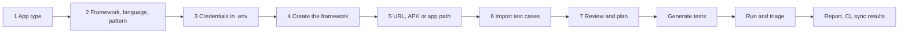

# TestPilot MCP

TestPilot is an MCP server that walks a team from "we have test cases somewhere" to "automated tests run in CI and report back", inside the AI tool they already use: Cursor, Claude Code, Claude Desktop, claude.ai, ChatGPT, VS Code with Copilot, Antigravity, Codex, Gemini CLI and any other MCP client.

It asks one question at a time, explains every choice in plain language, previews every file before writing it, and saves everything in the repository so the next person, or the next AI tool, carries on where the last one stopped.

- **Web** with Playwright, **Android and iOS** with Appium, **Windows and macOS desktop** with Appium, **Electron** and **API** with Playwright.
- **Test cases from** Jira, Xray, Zephyr Scale, TestRail, BrowserStack Test Management, Azure Test Plans, Excel, CSV, Word, Gherkin and Markdown.
- **Power features**: watch it test a case live in a real browser, self-healing locators with your approval, failure stories from traces, flaky-test quarantine, a quality gate for test code, explained accessibility checks, visual checks that hide changing areas, a coverage and traceability map, a team dashboard, and one-request add-ons (log in once, test-data factory, faster CI, cloud browsers, API tests from OpenAPI, companion MCP servers, company rules). See [docs/power-features.md](docs/power-features.md).
- **Results back to** Xray, Zephyr Scale, TestRail, BrowserStack Test Management and Azure Test Plans, plus HTML and Markdown reports and CI pipelines for GitHub Actions, Azure DevOps, GitLab and Jenkins.

**Start here:** say **"Set up test automation"** (or use `/qa-setup`). TestPilot first asks what kind of app you have (website, Android, iPhone, desktop and more), then which framework, then which language, one question at a time, and saves every answer in `.testpilot/`.

**Never tested anything?** Open an empty folder and say **"test my app at https://staging.yourcompany.com"** (or use `/qa-start`). TestPilot needs only the address and picks the recommended setup for you (Playwright with TypeScript); it checks every page for broken links, errors, slow pages and phone layout problems, explains what it found in plain words, writes starter tests and runs them. Every question in the guided setup also accepts "not sure", and "what is a flaky test?" gets an everyday answer. See [docs/beginners.md](docs/beginners.md).

**Try it in five minutes:** say "give me the TestPilot demo" (or use `/qa-demo`). TestPilot sets up a practice shop on your computer and walks you through the whole story: create the framework, watch it test live, generate and run tests, break the app, heal the test, and show the coverage map.

[](https://github.com/seawandererind-hash/testpilot-mcp/actions/workflows/ci.yml) [](https://github.com/seawandererind-hash/testpilot-mcp/actions/workflows/device-check.yml) [](https://github.com/seawandererind-hash/testpilot-mcp/actions/workflows/scorecard.yml)

## How it works



| Step | What you are asked | What TestPilot does |
|---|---|---|
| 1. App type | Web, Android, iOS, both, Windows, macOS, Electron, API or hybrid | Detects what the repository already has and suggests the best fit |
| 2. Framework | Framework, language, design pattern (Page Object Model by default), where tests run, CI, reports | Explains the pros and cons of each option and records the choice in `.testpilot/decisions.md`. The language is yours to pick: Playwright in **TypeScript** or **JavaScript**, or **Selenium with Java** (Maven + TestNG), each with the Page Object Model or **Cucumber BDD** |
| 3. Credentials | Nothing in chat | Writes `.env.example`, adds `.env` to `.gitignore`, and checks which keys are filled in without ever reading their values back |
| 4. Framework | "Can I create the project framework?" | Shows every file it will write, waits for your yes, then scaffolds the project and the AI instructions |
| 5. App | The test environment URL, APK, IPA or app path, and extras (exploration, accessibility, visual, API layer, test data, parallel runs) | Refuses production-looking URLs unless you confirm, and can explore the app to record stable locators |
| 6. Test cases | "Do you have the test cases in Jira, BrowserStack, Excel, Word…?" | Imports them into one common format, keeping links back to the source |
| 7. Review and plan | Which suggestions to accept | Scores each case (clarity, completeness, atomicity, determinism, automatability), marks AUTOMATE / MANUAL / NEEDS-REWORK, finds duplicates and gaps, and writes `plans/automation-plan.md` in waves for a named person to approve |
| Generate | "Shall I write the tests for the first wave?" | Writes page objects and tests named and tagged with the test-case id, with no fixed waits and no secrets in code. With BDD it writes Gherkin feature files plus step definitions (`playwright-bdd` or Cucumber-JVM) |
| Run | "Shall I run them?" | Runs them (`playwright test`, `bddgen`, `mvn test` or WebdriverIO, whichever the project uses), repeats them to catch flaky tests, and sorts each failure into locator, timing, data, environment, assertion or script, with advice |
| Report | CI system and where results go | Writes the HTML report and the pipeline, and sends results to your test-management tool after you approve |

You can stop at any point. `testpilot_status` (or `/qa-status`) tells anyone where the repository is and what comes next.

## What it saves in your repository

```
.testpilot/
  config.yaml          every non-secret choice
  state.json           where the wizard is, and approvals
  decisions.md         what was decided, why, by whom and when
  audit.log.jsonl      every tool call (secrets redacted)
  test-cases/          imported cases in one format, plus raw copies of the source
  reviews/             review reports
  exploration/         screens, elements and suggested locators
  runs/ reports/       run history and readable reports
plans/automation-plan.md
AGENTS.md  CLAUDE.md  .cursor/rules/  .agents/rules/  .github/copilot-instructions.md
.agents/skills/  .claude/skills/      skills every AI tool can use
.claude/agents/  .cursor/agents/      repo-specific QA agents (test writer, runner, page-object curator, case reviewer, framework guide)
.mcp.json  .cursor/mcp.json  .agents/mcp_config.json   (TestPilot, plus the Playwright MCP for web apps)
.env.example                          (your .env stays on your machine)
```

The AI instructions, skills and agents are regenerated from your choices whenever they change: each agent knows this repository's framework, language, pattern, folders and commands, so a teammate can ask `@qa-test-writer` for a test or `@qa-test-runner` for a triaged run months later without TestPilot re-explaining the stack. Anything you write between `<!-- keep -->` and `<!-- /keep -->` in those files is preserved.

## Install

You need Node.js 22.19 or newer. [docs/install.md](docs/install.md) has the steps for every AI tool, including Windows.

**Cursor**: click the button, then **Install** in Cursor.

[](https://cursor.com/en/install-mcp?name=testpilot&config=eyJjb21tYW5kIjoibnB4IiwiYXJncyI6WyIteSIsImh0dHBzOi8vZ2l0aHViLmNvbS9zZWF3YW5kZXJlcmluZC1oYXNoL3Rlc3RwaWxvdC1tY3AvcmVsZWFzZXMvZG93bmxvYWQvdjAuMS42L3Rlc3RwaWxvdC1tY3AtMC4xLjYudGd6Il19)

Teams on Cursor's Teams or Enterprise plans can also offer TestPilot as a plugin in their own marketplace: an admin opens **Dashboard → Plugins & MCPs → Team Marketplaces → Add Marketplace → Import from Repo** and pastes `https://github.com/seawandererind-hash/testpilot-mcp`. Everyone then finds **testpilot** under **Customize** and clicks **Install**.

**Claude Code**: install the plugin, which brings the server and the TestPilot skill:

```bash
claude plugin marketplace add seawandererind-hash/testpilot-mcp
claude plugin install testpilot@testpilot-mcp
```

**Antigravity, VS Code, Codex, Gemini CLI, Claude Desktop and others**: add this server entry ([where each tool keeps it](docs/install.md)):

```json
{
  "mcpServers": {
    "testpilot": {
      "command": "npx",
      "args": ["-y", "https://github.com/seawandererind-hash/testpilot-mcp/releases/download/v0.1.6/testpilot-mcp-0.1.6.tgz"]
    }
  }
}
```

ChatGPT and claude.ai only reach servers on the internet, so they use a hosted TestPilot that your platform team runs once for everyone: see [docs/hosting.md](docs/hosting.md).

Then say **"Set up test automation for this repo"**, or use the `/qa-setup` prompt.

> `npx` downloads the released package from GitHub the first time and reuses it after that; nothing else needs installing. Newer versions are on the [Releases page](https://github.com/seawandererind-hash/testpilot-mcp/releases).

## Safety rules it follows

- **Secrets never pass through the AI.** No tool accepts or returns a secret value. Credentials go in `.env`, which only you edit; TestPilot only reports whether each key is present and well-formed.
- **Nothing destructive or external happens without your yes.** Writing the framework, overwriting files, sending results to a tracker, writing CI pipelines, running against a non-test environment and opening pull requests all show a preview first. Where the AI tool supports forms, you approve in a form the AI cannot fill in.
- **Imported content is data, not instructions.** Test cases, web pages and app screens are never treated as commands; text that looks like an injected instruction is flagged.
- **It never writes outside the repository.** Paths are sandboxed against `..`, absolute paths and symbolic links.
- **Generated tests stay honest.** No fixed sleeps, no hard-coded secrets, and assertions are never weakened without the team agreeing.

More in [docs/security.md](docs/security.md).

## Tools, prompts and resources

| Tool | Purpose |
|---|---|
| `testpilot_status` | Where this repository is in the workflow, and the next step |
| `wizard` | Asks the next question, records answers, goes back to any step |
| `detect_repo`, `check_prerequisites` | What the repository already has; what to install on this machine |
| `write_env_template`, `check_env` | `.env.example` for the chosen integrations; presence-only checks |
| `preview_scaffold`, `scaffold_project` | Preview, then create the framework after approval |
| `regenerate_docs` | Rebuild AGENTS.md, rules and skills from the saved choices |
| `import_test_cases`, `list_test_cases`, `save_test_case` | Bring test cases in, browse them, edit one |
| `review_test_cases` | Score, verdict, duplicates, gaps and rewrite suggestions |
| `automation_plan` | Build, show and approve the wave plan |
| `explore_app` | Record screens, elements and stable locators |
| `preview_tests`, `generate_tests` | Show, then write page objects and tests for planned cases |
| `run_tests` | Run with stability repeats and failure triage |
| `publish_results` | Reports, CI pipelines and result sync |
| `live_test` | Drive a real browser through a test case while you watch, and record the locators that worked |
| `heal_tests` | Propose and apply locator fixes after your yes, explain failures from traces, score and quarantine flaky tests |
| `quality_scan` | Quality gate for test code, explained accessibility checks (WCAG 2.2), visual checks with smart masks |
| `insights` | Coverage and traceability map, metrics, team dashboard (shown as an interactive view where MCP Apps are supported) |
| `add_capability` | Log in once, test-data factory, faster CI, cloud browsers, API tests from OpenAPI, companion MCP servers, company rule pack |
| `demo_project` | A practice shop with the wizard filled in, for demos and first tries |
| `hosted_workspace` | Hosted mode only: add shared files, download a zip, open a pull request |

Prompts: `/qa-setup`, `/qa-import`, `/qa-plan`, `/qa-generate`, `/qa-run`, `/qa-status`, `/qa-demo`. Resources: `testpilot://state`, `testpilot://config`, `testpilot://plan`, `testpilot://reports/latest`.

TestPilot speaks both MCP protocol generations (2025-era clients such as Cursor, and 2026-07-28 clients) from one server.

## Documentation

- [docs/user-guide.md](docs/user-guide.md): a first session from start to finish, for people new to test automation
- [docs/install.md](docs/install.md): setup for every AI tool, Windows included
- [docs/hosting.md](docs/hosting.md): running the hosted TestPilot for ChatGPT and claude.ai
- [docs/security.md](docs/security.md): what TestPilot can and cannot do, for security reviews
- [docs/decisions.md](docs/decisions.md) and [docs/research.md](docs/research.md): design decisions and the research behind them

## For platform teams

- **Releasing.** `npm version patch` (or `minor`/`major`) updates every install link and plugin manifest (`scripts/sync-version.mjs`). Push, then run **Actions → Release → Run workflow** (or push the tag with `git push --follow-tags`). The workflow tests, packs and attaches `testpilot-mcp-<version>.tgz` to a GitHub release, and that version's generated MCP configs point at it.
- **Plugins.** `plugins/testpilot/` is the Cursor and Claude Code plugin (the server bundled into `server/` by `scripts/build-plugin.mjs` at each `npm version`, a skill and a Cursor rule); `.cursor-plugin/marketplace.json` and `.claude-plugin/marketplace.json` make this repository a marketplace for both. To use a company npm registry instead, set the package name in `package.json` to your scope, remove `testpilot.install`, and `npm publish`.
- **House style.** Templates live in `templates/` as Handlebars files: framework packs (`templates/playwright-ts`, `templates/appium-ts`), CI pipelines (`templates/ci`), and the AI instructions and skills (`templates/knowledge`). Change them once and every team gets the same structure.
- **New AI tools.** `templates/knowledge/client-map.json` says where each tool reads MCP config, instructions and skills. When a vendor moves a folder, edit that file; no code change is needed.
- **Hosted mode** for ChatGPT and claude.ai: [docs/hosting.md](docs/hosting.md).

## Development

```bash
npm ci
npm run build        # compile to dist/
npm test             # unit, protocol and end-to-end tests
npm run typecheck
npm run inspect:modern   # list tools with the MCP Inspector (also inspect:legacy)
```

The code is in `src/`: `core/` (store, wizard, paths, redaction), `catalog/` (frameworks and keys), `scaffold/`, `knowledge/` (AI files), `testcases/` (importers, review), `plan/`, `explore/`, `generate/`, `run/`, `report/`, `integrations/`, `remote/` (hosted mode) and `tools/` (the MCP tools).

## License

[MIT](LICENSE)
